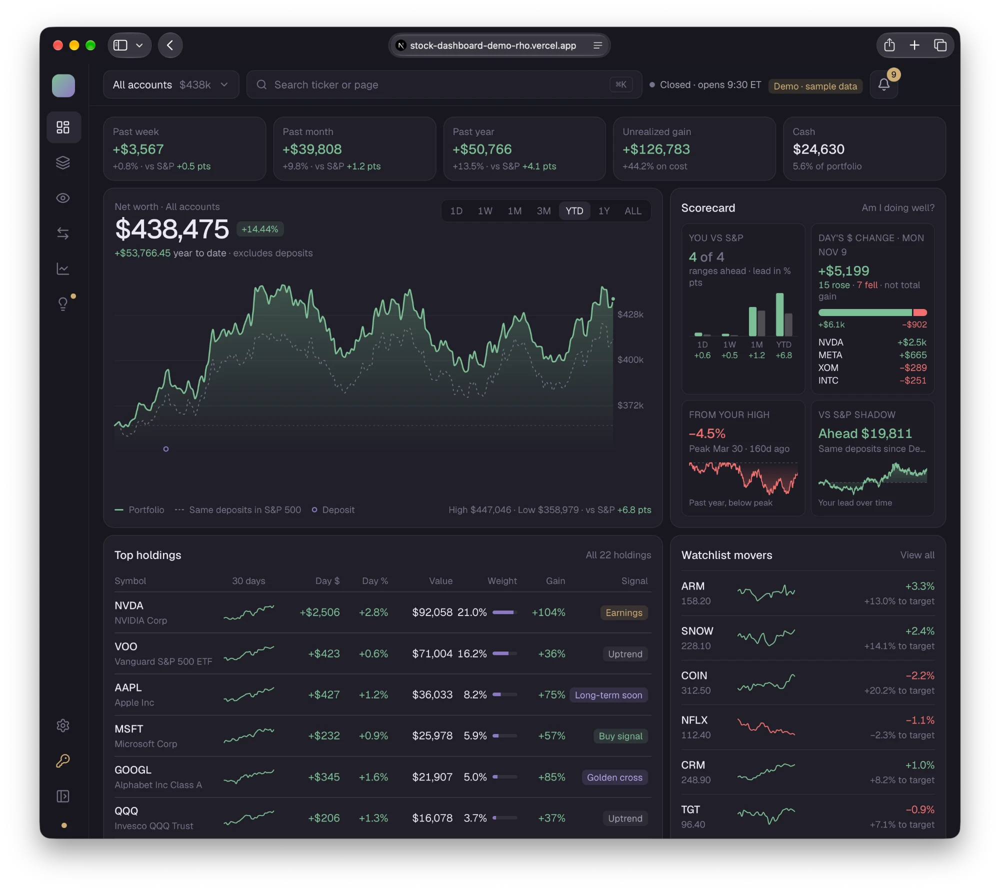
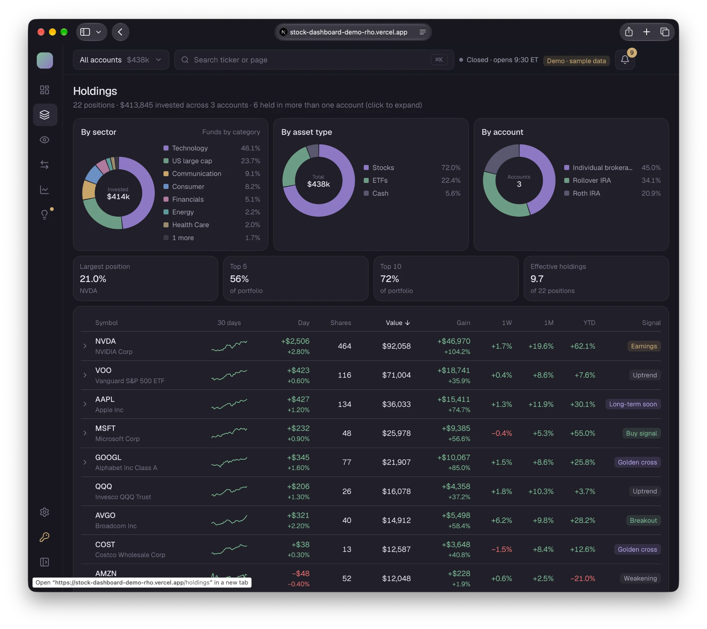
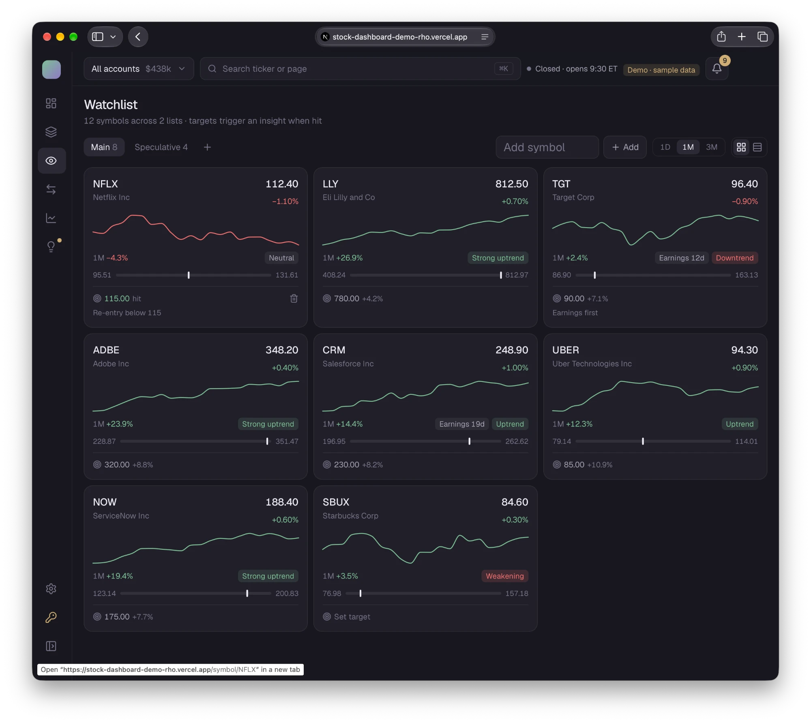
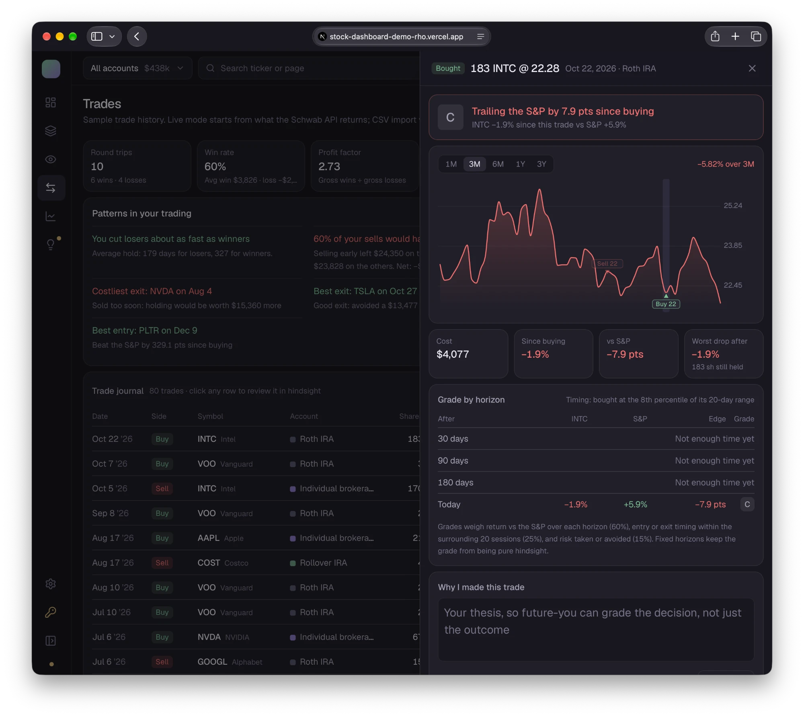
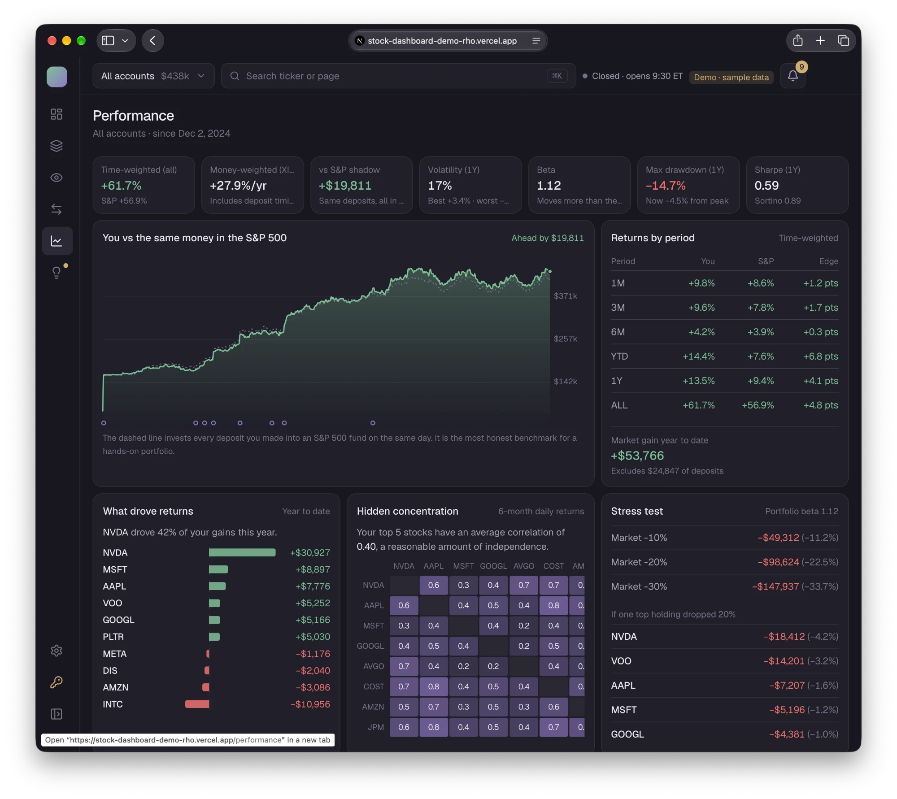
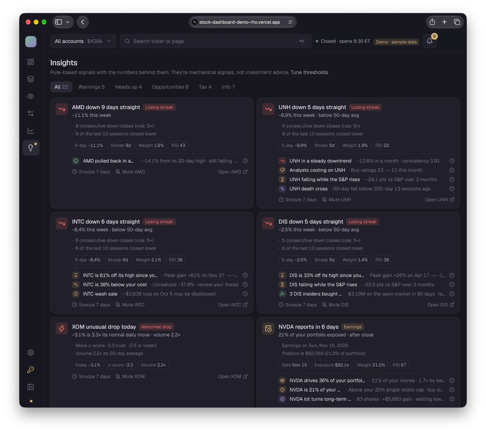

# Portfolio: a private dashboard for your Schwab accounts

See every Schwab account in one place: net worth over time against the S&P 500, holdings combined across accounts, a watchlist, trade history graded with hindsight, and rule-based signals for trends worth a look. It runs on your own computer or your own Vercel project, behind your own login.

It runs on realistic **sample data** until you connect Schwab, so you can try everything in about five minutes before setting up any API keys.



See [A tour of the app](#a-tour-of-the-app) for every page and what it shows.

---

## 1. Try it with sample data (5 minutes)

You need [Node.js](https://nodejs.org) 20.9 or newer and Git.

```bash
git clone https://github.com/joelrossol/stock-dashboard.git
cd stock-dashboard
npm install
cp .env.example .env.local
npm run dev
```

Open **https://127.0.0.1:3000**. Your browser warns about the certificate once: the dev server uses a self-signed certificate made on your machine, so choose *Advanced → Proceed*.

It opens straight into **demo mode**: three made-up accounts, no sign-in needed. None of this data is real. Live data stays locked until you set up a login (next section).

---

## 2. Connect your Schwab account

### First, set up your login

Live data only works behind a login, so nobody else can reach your accounts:

```bash
npm run set-password      # choose the email and password you'll sign in with
```

Restart `npm run dev` and sign in. Only a salted hash of the password is saved, in `.env.local`. On Vercel, copy the three `AUTH_*` values into the project's environment variables (section 4).

### a. Create a Schwab developer app (one time)

1. Sign in at [developer.schwab.com](https://developer.schwab.com) with your normal Schwab login.
2. **Dashboard → Apps → Create App.** Add both API products: **Accounts and Trading Production** and **Market Data Production**.
3. Set the **Callback URL** to exactly:
   ```
   https://127.0.0.1:3000/api/auth/schwab/callback
   ```
   If you'll also host it on Vercel, add that callback too (see section 4). Separate several URLs with commas.
4. Submit. Approval usually takes a few days, and the app shows **Ready For Use** when it's done.

### b. Add the keys and connect

1. Copy the app's **App Key** and **Secret** into `.env.local`:
   ```
   SCHWAB_APP_KEY=...
   SCHWAB_APP_SECRET=...
   ```
2. Restart `npm run dev`.
3. In the dashboard, go to **Settings → Connect Schwab** and sign in on Schwab's own site. You'll come straight back to the dashboard with live data.

**Schwab makes you sign in again every 7 days.** That's Schwab's rule, not the app's. The top bar warns you two days ahead, and reconnecting takes one click.

The app only **reads** your accounts. It has no code that places orders or moves money.

---

## 3. Add earnings, news and sectors (optional, free)

Get a free API key at [finnhub.io](https://finnhub.io/register) and add it to `.env.local`:

```
FINNHUB_API_KEY=...
```

This adds earnings dates, analyst ratings, company news, insider buying and stock sectors. Without it, everything else still works.

---

## 4. Host it on Vercel (optional)

1. Push your copy of the repo to a **private** GitHub repo (the license doesn't allow republishing it), then **Import** it at [vercel.com/new](https://vercel.com/new).
2. **Add a database:** Project → **Storage → Create → Turso** (free), connected to the **Production** environment. The app finds Turso's variables automatically and creates its tables on first use. Without a database it falls back to a temporary one that resets often, which means reconnecting Schwab often.
3. **Add environment variables** (Project → Settings → Environment Variables, with **Production** ticked):

   | Variable | Value |
   |---|---|
   | `AUTH_EMAIL` | Copy from your `.env.local` |
   | `AUTH_PASSWORD_HASH` | Copy from your `.env.local` (a hash, never your actual password) |
   | `AUTH_SECRET` | Copy from your `.env.local` |
   | `SCHWAB_APP_KEY` | Your Schwab App Key |
   | `SCHWAB_APP_SECRET` | Your Schwab Secret |
   | `FINNHUB_API_KEY` | Optional |

4. **Redeploy.** Vercel only applies environment variable changes to new deployments.
5. In your Schwab app, add the hosted callback: `https://<your-domain>/api/auth/schwab/callback`.
6. Open the site, sign in, then **Settings → Connect Schwab**.

**Settings → Server configuration** shows a check or a cross for each variable, so you can see right away if something's missing.

### Custom domain

Vercel → Project → **Settings → Domains → Add**, then create the DNS record it shows you at your domain registrar. Add the new domain's callback URL to your Schwab app as well.

---

## Environment variables

| Variable | Needed for | Notes |
|---|---|---|
| `AUTH_EMAIL`, `AUTH_PASSWORD_HASH`, `AUTH_SECRET` | Signing in | Written by `npm run set-password`. Only a salted scrypt hash of the password is stored. |
| `SCHWAB_APP_KEY`, `SCHWAB_APP_SECRET` | Live data | From developer.schwab.com |
| `FINNHUB_API_KEY` | Earnings, news, ratings, insider trades, sectors | Optional |
| `DATA_MODE` | | `auto` (default): live when connected, otherwise sample data. `mock` always uses sample data. You can also switch in Settings. |
| `SCHWAB_CALLBACK_URL` | | Optional. Defaults to `https://127.0.0.1:3000/...` locally and your production domain on Vercel. |
| `TOKEN_ENCRYPTION_KEY` | | Optional. Encrypts stored Schwab tokens; derived from `AUTH_SECRET` if not set. |
| `DATABASE_URL`, `DATABASE_AUTH_TOKEN` | | Optional. Locally a SQLite file is created at `data/dashboard.db`. On Vercel, Turso's variables are found automatically. |

---

## A tour of the app

Every screenshot below is the built-in sample data, so none of it is real. Each page says where its numbers come from: **Schwab** (your accounts and market data), **Finnhub** (earnings, analysts, news, sectors, insider trades), or **calculated** by the app from those two.

The account switcher in the top bar narrows every page to one account, and **⌘K** jumps to any ticker or page. Click any ticker to open its detail page.

### Overview: how am I doing?


| Section | What it shows | Data from |
|---|---|---|
| Growth tiles | Gain over the past week, month and year, each compared with the S&P 500; unrealized gain; cash | Schwab, calculated |
| Net worth | Total value over 1D to ALL, against the same deposits invested in the S&P 500 (dotted line), with deposits marked | Schwab, calculated |
| Scorecard | How many ranges you're ahead of the S&P; today's $ change with the biggest winners and losers; distance from your high; lead over the S&P "shadow" portfolio | Calculated |
| Top holdings | Largest positions with 30-day sparkline, today's move, weight, total gain and the strongest signal | Schwab, calculated |
| Watchlist movers | Today's biggest moves on your watchlist and distance to your target price | Schwab |
| Further down | Signals, accounts, a heatmap of today or this week, and upcoming earnings and dividends | All three |

### Holdings: what do I own?



| Section | What it shows | Data from |
|---|---|---|
| Breakdowns | Invested money by sector (funds grouped by category, such as US large cap or bonds), by asset type, and by account | Schwab, Finnhub |
| Concentration | Largest position, top 5, top 10, and "effective holdings" (how many equal-size positions your portfolio behaves like) | Calculated |
| Positions table | Every holding combined across accounts: 30-day sparkline, day $ and %, shares, value, total gain, 1W / 1M / YTD returns and the top signal. Rows held in more than one account expand to show each account. Sortable. | Schwab, calculated |

### Watchlist: what am I watching?



| Section | What it shows | Data from |
|---|---|---|
| Lists | Several named lists (for example Main and Speculative); add or remove symbols | Saved in your database |
| Tiles or table | Price, day %, a 1D / 1M / 3M sparkline, trend label, 52-week range bar and upcoming earnings | Schwab, Finnhub, calculated |
| Targets | Set a target price and a note. Hitting the target creates a signal. | Saved in your database |

Schwab's API doesn't expose your Schwab watchlists, so the app keeps its own.

### Trades: am I making good decisions?



| Section | What it shows | Data from |
|---|---|---|
| Scorecard | Round trips, win rate, average win and loss, profit factor | Schwab transactions, calculated |
| Decision grades | How your trades grade overall, A to F | Calculated |
| Patterns | How long you hold losers vs winners, how often selling early cost you, your costliest and best exits, your best entry | Calculated |
| Trade journal | Every buy and sell. Click one to open it. | Schwab |
| Trade detail | Price chart with your buys and sells marked; return since the trade vs the S&P; worst drop afterwards; an A–F grade at 30, 90 and 180 days and today; your timing within the surrounding 20 sessions; and a note on why you made the trade | Calculated, your notes |

Grades weigh return vs the S&P (60%), timing (25%) and risk (15%) at fixed horizons, so a trade isn't judged purely in hindsight.

### Performance: am I beating the market?



| Section | What it shows | Data from |
|---|---|---|
| Headline numbers | Time-weighted return (your skill, deposits excluded), money-weighted return (your actual money, deposit timing included), lead over the S&P shadow portfolio, volatility, beta, max drawdown, Sharpe and Sortino | Calculated |
| You vs the S&P | Your value against the same deposits put into an S&P 500 fund on the same days | Calculated |
| Returns by period | You vs the S&P for 1M, 3M, 6M, YTD, 1Y and all time, plus market gain year to date | Calculated |
| What drove returns | Each holding's contribution to this year's gain | Calculated |
| Hidden concentration | How closely your top holdings move together | Calculated |
| Stress test | Estimated loss if the market falls 10 / 20 / 30%, or if one top holding falls 20% | Calculated |
| Further down | Dividend income and a tax view (short- vs long-term lots, harvest candidates, wash-sale check) | Schwab, calculated |

### Insights: what needs my attention?



| Section | What it shows | Data from |
|---|---|---|
| Signal cards | One card per stock, most urgent first, with the rule that fired, the numbers behind it and any related signals | Calculated, Finnhub |
| Filters | Warnings, heads up, opportunities, tax and info | |
| Actions | Snooze a card for 7 days, mute a ticker, or open the stock | Saved in your database |

Signals cover around 30 rules: losing streaks, steady downtrends, abnormal drops, distance below your cost or your high, laggards, concentration and risk share, correlated clusters, earnings dates and gaps, analyst upgrades and downgrades, insider buying, buy-more and dip setups, breakouts, golden and death crosses, harvest and wash-sale checks, and a market check that tones down buy signals in a weak market. Percentage rules adjust for each stock's volatility. Every threshold can be changed in **Settings**. These are mechanical rules, not investment advice.

### Stock detail (any ticker)

| Section | What it shows | Data from |
|---|---|---|
| Chart | Price with 20/50/200-day averages and your buys and sells marked; candlesticks optional | Schwab |
| Your position | Shares and cost in each account, gain, weight | Schwab |
| Key stats and trend math | 52-week range, P/E, dividend yield, RSI, trend slope and consistency, move size vs normal | Schwab, calculated |
| Earnings and analysts | Next earnings date and the trend in analyst ratings | Finnhub |
| News and signals | Recent headlines and every signal for this stock | Finnhub, calculated |

### Settings

Connect or reconnect Schwab, switch between live and sample data, rename accounts and set their tax treatment, and tune every signal threshold. **Server configuration** shows a check or a cross for each environment variable (names only, never values), so you can see what's missing right away.

### How fresh is the data?

| Data | Refreshed |
|---|---|
| Balances, positions, quotes | Every minute |
| Intraday charts | Every 2 minutes |
| Daily price history | Once a day (stored in the database; today's price comes from the live quote) |
| Transactions | Last 90 days on every load; 3 years back once a day, in the background |
| Earnings / ratings / news / insider trades / company profiles | 6 hours / 1 day / 1 hour / 1 day / 7 days |

Schwab's API only keeps about a year of transactions and has no balance history, so the app stores every transaction it sees and records each day's balances. Your history gets more accurate the longer you use it.

---

## Privacy and security

- **No login, no live data.** With no `AUTH_*` variables set, the app runs in demo mode: anyone can open it, but it only shows the made-up sample accounts, and connecting Schwab is locked. If any `AUTH_*` variable is set, even wrongly, the whole site stays behind the login instead.
- **The whole site is behind your login** once it's set up. A server-side check turns away anyone without a valid session before any page, API route or action runs. Sessions end after 12 hours idle or 7 days. Five wrong passwords lock sign-in for 15 minutes. Search engines are told not to index it.
- **Your keys never go in git.** `.env.local` and the database are gitignored, and a pre-commit hook blocks any commit containing `.env` files, certificates, the database, or any value from `.env.local`. Run it on demand with `npm run check:secrets`.
- **Schwab tokens are encrypted** (AES-256-GCM) in your database.
- **Sample data is invented.** The accounts in `lib/data/mock/` don't belong to anyone.
- Change your login any time with `npm run set-password`, then update `AUTH_PASSWORD_HASH` on Vercel and redeploy.

---

## Troubleshooting

| Problem | Fix |
|---|---|
| Browser says the connection isn't private (local) | Expected for the local self-signed certificate. Choose *Advanced → Proceed*. |
| "Login isn't set up" | One or more `AUTH_*` variables is set but wrong (Settings → Server configuration says which). Run `npm run set-password`; on Vercel, copy all three `AUTH_*` variables to **Production** and redeploy. |
| It says "Demo · sample data" and won't connect Schwab | No login is set up yet. Run `npm run set-password` (and add the `AUTH_*` variables on Vercel). |
| Settings shows a variable as "not found" on Vercel | Check that the variable has **Production** ticked, then redeploy. |
| Schwab says the callback URL is invalid | The URL in your Schwab app must match the one shown in Settings exactly, including `https` and the port. |
| You keep having to reconnect Schwab on Vercel | Settings → Server configuration → Database should say "Turso (hosted)". If it says "temporary", add Turso (section 4). |
| "Live data failed, so sample data is showing" | The error is shown in Settings. Usually it's an expired login: click **Reconnect**. |

---

## Development

```bash
npm run dev          # HTTPS dev server on https://127.0.0.1:3000
npm test             # analytics and scenario tests (Vitest)
npm run typecheck
npm run lint
npm run build
```

```
app/                   pages (App Router), server actions, Schwab OAuth routes
lib/data/schwab/*      Schwab API client, OAuth, zod schemas, normalizers
lib/data/finnhub/*     Finnhub client and normalizers
lib/data/mock/*        the sample world, returned in Schwab's own response format
lib/data/load.ts       loads everything into one PortfolioData object (live or sample)
lib/analytics/*        indicators, trend score, signals, returns, risk, trade grading
lib/model.ts           data + account scope + settings → what the pages render
lib/db/*               SQLite locally / Turso on Vercel, via Drizzle
components/charts/*    custom SVG charts
```

Sample data goes through the same normalizers as live data, so the sample and live versions of every page are built by the same code.

Ideas and parked features live in [ROADMAP.md](ROADMAP.md).

---

## License

[PolyForm Strict 1.0.0](LICENSE.md). You're welcome to download it and run it for yourself, for personal, non-commercial use. You may not change it, build on it, redistribute it, or use it commercially. All rights not granted are reserved by the author. For anything else, ask first.
